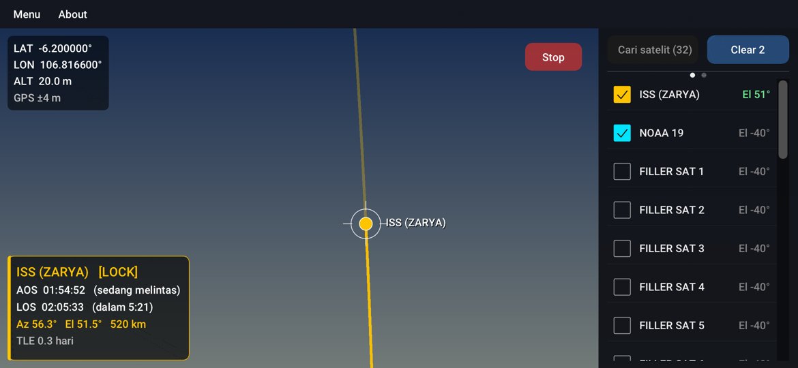

# SatTracker

  

Aplikasi Android pelacak satelit dengan **overlay augmented reality (AR)** di kamera. Arahkan ponsel ke langit, dan SatTracker menampilkan posisi satelit, lintasannya, serta waktu **AOS** dan **LOS** secara realtime.

> Produk hasil penelitian dan pengembangan (litbang) tim **AMSAT-ID** — <https://amsat-id.org/>

**[⬇ Unduh APK (Beta V1.0.0)](https://github.com/YD1RUH/SatTracker/releases/download/Beta-V1.0.0/SatTracker.apk)**

## Fitur

- **Kamera utama + data GPS** — tombol **Start** membuka kamera belakang dan menampilkan latitude, longitude, dan altitude dari GPS di layar.
- **Import TLE** — muat file TLE (format 2 baris atau 3 baris) lewat `Menu > Import TLE`. TLE terakhir diingat dan dimuat otomatis saat aplikasi dibuka kembali.
- **Layout 3/4 kamera : 1/4 daftar satelit** setelah TLE dimuat, baik portrait maupun landscape.
- **Overlay satelit dinamis** untuk satelit yang dicentang: nama, AOS, LOS, titik satelit (merah), dan lintasan di langit (hijau stabilo).
- **Beberapa satelit sekaligus** (maksimal 12) — informasi nama, AOS, dan LOS tampil bergantian.
- **Lock** — saat satelit melintas, tampilan terkunci ke satelit itu sampai LOS. Jika satelit di luar layar, panah penunjuk arah muncul di tepi layar.
- **Pencarian satelit** berdasarkan nama atau nomor katalog.
- **Countdown lintasan** — geser daftar satelit ke kiri untuk melihat hitung mundur AOS/LOS satelit yang dicentang; geser ke kanan untuk kembali.
- **Auto rotate** — mengikuti rotasi ponsel.
- Penanda arah mata angin (N/E/S/W) dan garis horizon untuk membantu memeriksa keselarasan sensor.

## Instalasi

1. Unduh file APK: [SatTracker.apk](https://github.com/YD1RUH/SatTracker/releases/download/Beta-V1.0.0/SatTracker.apk) (atau dari halaman [Releases](https://github.com/YD1RUH/SatTracker/releases)).
2. Buka file APK di ponsel. Jika diminta, izinkan **Install dari sumber tidak dikenal** untuk aplikasi yang Anda pakai membukanya.
3. Buka **SatTracker**.

## Cara pakai

1. Unduh file TLE, misalnya dari [CelesTrak](https://celestrak.org/NORAD/elements/) — contoh satelit amatir:
   `https://celestrak.org/NORAD/elements/gp.php?GROUP=amateur&FORMAT=tle`
2. Buka aplikasi, pilih **Menu > Import TLE**, lalu pilih file tersebut.
3. Tekan **Start**, izinkan akses kamera dan lokasi, lalu tunggu GPS mendapatkan posisi.
4. Centang satelit pada daftar (bagian bawah layar, atau sisi kanan saat landscape). Gunakan kolom pencarian untuk menemukan satelit tertentu.
5. Arahkan ponsel ke langit mengikuti titik dan lintasan di layar.

**Tips**
- Kalibrasi kompas dengan menggerakkan ponsel membentuk angka 8, dan jauhkan dari benda logam atau magnet.
- Gunakan TLE yang masih baru. Usia TLE ditampilkan di kartu informasi (di atas 14 hari ditandai oranye) karena akurasi prediksi menurun seiring waktu.
- Pastikan jam ponsel diatur otomatis, karena perhitungan memakai waktu sistem.

## Kebutuhan

- Android 7.0 (API 24) atau lebih baru
- OpenGL ES 3.0
- Kamera belakang, GPS, dan sensor rotasi (umumnya ada di semua ponsel modern)

## Izin yang diminta

| Izin | Kegunaan |
|---|---|
| Kamera | Menampilkan gambar kamera sebagai latar overlay AR |
| Lokasi (GPS) | Menentukan posisi pengamat untuk menghitung AOS/LOS dan arah satelit |

Aplikasi tidak meminta izin penyimpanan; file TLE dibuka lewat pemilih file Android. Aplikasi tidak mengirim data apa pun ke server.

## Batasan

- Ketepatan penempatan overlay bergantung pada sensor ponsel (umumnya beberapa derajat) dan perkiraan sudut pandang kamera.
- Aplikasi masih berstatus **beta**. Jika menemukan masalah (misalnya arah gambar atau titik satelit tidak sesuai di perangkat tertentu), laporkan lewat **Issues** dengan menyebutkan tipe ponsel dan versi Android.
- Sebagian keyboard dengan saran teks/prediksi kadang tidak mengirim huruf dengan benar ke kolom pencarian; matikan saran teks atau coba keyboard lain.

## Kredit

- **AMSAT-ID** — tim litbang pembuat aplikasi: <https://amsat-id.org/>
- [Dear ImGui](https://github.com/ocornut/imgui) — antarmuka (lisensi MIT)
- SGP4 — kode referensi David Vallado untuk propagasi orbit
- Font [Roboto](https://fonts.google.com/specimen/Roboto) (Apache License 2.0)
- Data orbit (TLE): [CelesTrak](https://celestrak.org/)
